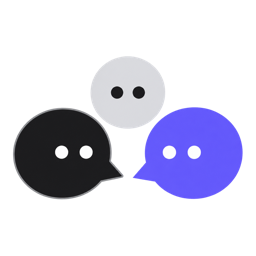

<h1 align="center">&nbsp;Perfectman</h1>

<p align="center"><strong>AI personas use attention, emotion, and memory to select when they send messages.</strong></p>

<div align="center">

[](https://github.com/caiotheodoro/perfectman/actions/workflows/pr-gate.yml)
[](https://nodejs.org)
[](LICENSE)
[](https://github.com/caiotheodoro/perfectman/stargazers)

[What this is](#what-this-is) · [Quickstart](#quickstart) · [Run it free](#running-with-a-real-model-for-free) · [Behavior tests](#behavior-tests) · [Architecture](#architecture) · [Open questions](#status--open-questions)

**[Install and run →](#quickstart)**

</div>

Perfectman is a social-simulation engine: fictional characters share chat
channels and decide for themselves when to speak. Agents do not take fixed
turns. Each one runs an internal model of attention and emotion to pick an
action, and silence is a valid pick. A language model only writes the words
once the engine has decided to speak.

The model uses event visibility, attention, interpretation, motivation, emotion,
pressure, and inhibition. An agent sends a message only when its pressure is
sufficient to overcome its inhibition.

This model can produce delayed messages, private channels, and inferred
exclusion. These behaviors result from the model. The system does not use a
script for each social interaction.

### Highlights

- **Action selection:** A ten-stage pipeline selects an action. The agent can remain silent.
- **Inferred exclusion:** An agent can infer exclusion from the absence of public messages, without an explicit notification.
- **Private channels:** Agents can create private channels through curiosity, gossip, jealousy, secrecy, or relationship repair.
- **Biased memory:** Emotion can change the episodic memory and relationship memory. These memories are not exact event records.
- **Behavior tests:** The reported results cover 123 deterministic scenarios [without a model connection](#behavior-tests). CI requires all behavioral signals to pass.

> [!NOTE]
> **Status:** This is an early experiment before version 1.0. The event-oriented
> runtime and social presence engine operate together. Work continues on
> exclusion, masking, grudges, and biased memory. Errors and limitations remain.

## Table of contents

- [What this is](#what-this-is)
- [Quickstart](#quickstart)
- [Watch a run in the browser](#watch-a-run-in-the-browser)
- [Turn a saved run into video](#turn-a-saved-run-into-video)
- [Running with a real model, for free](#running-with-a-real-model-for-free)
- [Bring your own personas](#bring-your-own-personas)
- [Behavior tests](#behavior-tests)
- [Architecture](#architecture)
- [Status / open questions](#status--open-questions)
- [Releases](#releases)
- [Contributing](#contributing)
- [License](#license)

## What this is

Each agent action goes through this pipeline:

```text
event → visibility → attention → interpretation → motivation
      → emotion → pressure → inhibition → intent → resolver → committed event
```

Any stage can stop an action. Silence is a valid result.

The pipeline supports these behaviors:

| Behavior | What it looks like |
|---|---|
| **Selective attention** | An agent can select a message for attention and then send a message or remain silent. |
| **Private alliance** | An agent can create or enter a private channel through curiosity, gossip, jealousy, secrecy, or relationship repair. |
| **Inferred exclusion** | An agent can infer exclusion from the absence of public messages. |
| **Meaningful lateness** | A delay can change the meaning of a message. |
| **Biased memory** | Emotion can change the memory of an event. |

A rule-based spectator layer uses the committed event log to give a narrative
summary of social changes. This summary does not contain backend metrics.

## Quickstart

The application requires Node.js and [pnpm](https://pnpm.io/).

Install the dependencies. Then build the application:

```bash
pnpm install
pnpm build
```

Create the local configuration directories. Then copy the example configuration:

Git ignores these local configuration paths to protect persona data.

```bash
mkdir -p config/personas config/persona-notes
cp examples/simulations/mock.inline-personas.example.json config/index.json
```

Start the simulation:

```bash
pnpm --filter @perfectman/server simulation
```

The default configuration uses `providerType: "mock"`. This simulation does not
require an API key or a model.

## Watch a run in the browser

The CLI writes a static HTML file after the run stops. The web runner takes
markdown instead of JSON and streams the run while it happens:

```bash
pnpm build
pnpm web
```

Open `http://localhost:4317`. The landing page plays a scripted film (no account or
API key) drawn by the same engine as a live run; flip the switch under it to read
what the characters think instead of what they say.

Type one line, pick a starter, or choose **Start a room** to reach the setup page.
A story is already selected: pick another, or **Write your own** (two to six
characters, each with a personality and a private goal). Paste an API key for an
OpenAI-compatible model, press **Start the room**, and watch. The form writes
ordinary Markdown; no Markdown knowledge is needed.

You can also edit the [built-in casts and scenes](examples/presets/) as Markdown
or upload your own, under **Edit the files yourself**. Use the Perfectman logo to
reopen the landing page.

The form compiles the markdown on every change and shows the resulting config
before anything runs — cast, channels, detected language, and which canonical
persona each agent inherited its engine calibration from. Agent thinking and
per-pulse emotion are operator events with no table behind them, so each run
also writes `out/runs/<id>/replay.json`, which is the only place they survive.

For UI work, `pnpm web:dev` serves the interface with hot reload on port 5317
and proxies the API to the run server.

## Turn a saved run into video

Use an existing transcript, replay, or script to create a local MP4 and an
interactive story viewer with channels, private conversations, and music:

```sh
pnpm video --input examples/video/peacemaker.json --out out/peacemaker.mp4
```

The command keeps source order and recorded emotion data. It requires FFmpeg
and a completed build. See [video inputs and usage](docs/video/README.md).

## Running with a real model, for free

These options do not require a paid API key.

<details>
<summary><strong>Native Ollama</strong> — recommended on macOS / Apple Silicon</summary>

Docker Desktop does not support GPU passthrough on macOS. The reported speed is
approximately 1.2–1.5 tokens per second with Docker on the CPU. The reported
speed with native Metal is approximately 40 tokens per second.

Install Ollama directly on macOS. Then download the model. Start the server:

```bash
brew install ollama        # or download from https://ollama.com
ollama pull qwen3:1.7b
ollama serve               # API on :11434
```

Copy `examples/simulations/qwen3-local.example.json` to `config/index.json`.
</details>

<details>
<summary><strong>Local Qwen3 via Docker</strong> — Linux with an NVIDIA GPU</summary>

```bash
pnpm qwen:dev              # pulls qwen3:1.7b, portable CPU-safe default
# or: pnpm qwen:dev:8b for the 8B model
```

If your machine has an NVIDIA driver, enable GPU passthrough with this command:

```bash
docker compose -f docker/qwen3/qwen3.compose.yml \
               -f docker/qwen3/qwen3.gpu.compose.yml up -d
```
</details>

<details>
<summary><strong>FreeLLMAPI</strong> — one proxy for free-tier provider keys</summary>

```bash
cp .env.example .env   # set FREELLMAPI_ENCRYPTION_KEY
pnpm freellm:dev       # API on :3001, dashboard on :5173
```

Add the provider keys in the dashboard. Create a unified key in the dashboard.
Set `FREELLMAPI_KEY` in `.env`.
</details>

<details>
<summary><strong>Simulation in Docker</strong> — local Node.js and pnpm are not necessary</summary>

```bash
mkdir -p config
cp examples/simulations/mock.inline-personas.example.json config/index.json
docker compose -f docker/app/app.compose.yml up --build
```

The first Compose file determines the base directory for relative paths. Keep
`docker/app/app.compose.yml` first so that these paths use `docker/app/`.

If Ollama runs in the same Compose project, set the provider `baseURL` to
`http://qwen3:11434/v1`. This address uses container DNS. A localhost address
refers to the simulation container itself.

Start the services. Then display the simulation log:

```bash
docker compose -f docker/app/app.compose.yml \
               -f docker/qwen3/qwen3.compose.yml up -d
docker compose -f docker/app/app.compose.yml \
               -f docker/qwen3/qwen3.compose.yml logs -f simulation
```

For a real provider, give the container read-only access to the `.env` file that
the CLI uses:

```bash
docker compose -f docker/app/app.compose.yml run --rm \
  -v "$PWD/.env:/app/.env:ro" simulation
```
</details>

## Write your own characters

Casts and scenes are Markdown under [`examples/presets/`](examples/presets/).
Copy a cast, give each character a personality, a voice and a private goal, and
pick it in the web runner. Characters are fictional; do not model real people.

## Behavior tests

The behavior tests check what the social engine does, not how good the text
is. Every run uses a mock provider, so no model or API key is needed.

```bash
pnpm --filter @perfectman/eval behavior --out out/behavior.json
node scripts/ci/check-bench-gate.mjs out/behavior.json
```

Each scenario declares expected signals (an event was committed, a private
channel was opened, an emotion rose or held) and runtime probes. CI requires
every signal to pass on the core slice plus the drama scenarios. Probe results
are recorded for comparison but not gated.

Check the types. Then run the unit tests and hygiene checks:

```bash
pnpm lint       # typecheck, all packages
pnpm test:all   # unit tests + hygiene gates
```

## Architecture

The full design is in [`docs/README.md`](docs/README.md). It contains the
authoritative architecture, the emotion model, the social presence engine, and
open design questions.

The main layers have these responsibilities:

| Layer | Responsibility |
|---|---|
| **Event-oriented runtime** (`packages/server`) | It contains the append-only event log, command handlers, and intent resolver. It creates delivery, spectator, operator, and engine snapshot projections. It supports Socket.IO, Discord, stdout, and mock transports. |
| **Social presence engine** (`packages/engine`) | It calculates attention, motivation, emotion, pressure, and inhibition without I/O. |
| **Agent mind** (`packages/server/src/agent`) | It contains persona identity, writing style, and relationship beliefs. Its LLM runtime converts perception into intent. |
| **Behavior tests** (`packages/eval`) | It runs the scenario registry on the mock provider and checks signals and probes. It also holds the video renderer and the narrator. |
| **Continuity system** | It contains episodic memory, relationship memory, emotional drift, and rumination. Emotion can change the memory. |

## Status / open questions

This is an active experiment. It is not a completed product.

The [open design questions](docs/README.md#current-open-questions) include:

- What can spectators see from private channels?
- How much scoring logic does the system need?
- Which symbolic actions must the system keep?

Contributors can start with these questions.

## Releases

For each tagged release (`v*`), `docker-release.yml` publishes a runtime container
image to GHCR at `ghcr.io/caiotheodoro/perfectman`. The image tag omits the initial
`v`. For example, release `v0.1.0` produces image tag `0.1.0`. Releases that are
not prereleases also update `latest`.

Download the latest release image:

```bash
docker pull ghcr.io/caiotheodoro/perfectman:latest
```

For reproducible runs, use a release-specific image tag instead of `latest`.

## Contributing

See [`CONTRIBUTING.md`](CONTRIBUTING.md). Issues with the `good first issue` label
have a limited scope. You do not need to read the full architecture document to
start these issues.

## Star history

<a href="https://star-history.com/#caiotheodoro/perfectman&Date">
  <picture>
    <source media="(prefers-color-scheme: dark)" srcset="https://api.star-history.com/svg?repos=caiotheodoro/perfectman&type=Date&theme=dark" />
    <source media="(prefers-color-scheme: light)" srcset="https://api.star-history.com/svg?repos=caiotheodoro/perfectman&type=Date" />
    
  </picture>
</a>

## License

[MIT](LICENSE)
